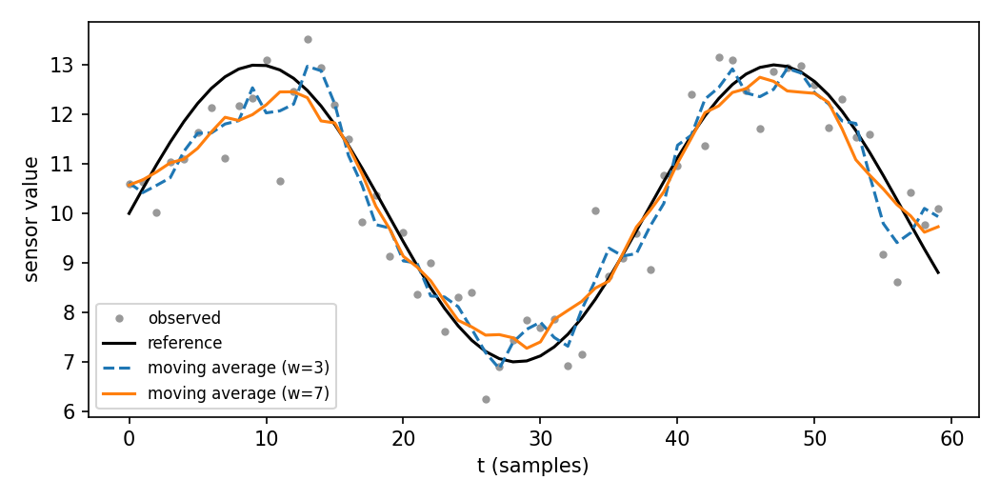

<!--
COMMON ANSWER FILE. Do not edit sections by hand while an agent is working; write
sections only with:  python3 tools/answer_section.py put <ID> --from <draft.md>
Rules: each section sits between its own BEGIN/END markers on their own lines;
the meta line is written by the script; cite with [@key] (keys in the .bib file);
cite figures/tables from work/results/ by relative path, e.g.
{#fig:q2-1}
The sample sections below are replaced by `answer_section.py init`, which
generates one section per question in context/assignment.md.
-->

<!-- BEGIN Q1 -->
## Q1. Reproducibility practices
<!-- meta: words=163/300 | criteria=C1,C3 | updated=2026-10-19 | status=revised -->

[Demo placeholder answer, written to test the pipeline rather than to model a good answer.]
Reproducibility means another analyst can re-run an analysis and obtain the same result [@dsci9001week3].

**Environment pinning.** Analyses often fail to reproduce because the computational environment
is not recorded [@nguyen2024practical]. Lock files address this by recording package versions, but
lock files alone do not capture operating-system libraries [@nguyen2024practical], so containers
may be needed. Containers close that gap but add build and maintenance overhead, so for a short
analysis a lock file plus a recorded operating-system version is often the proportionate choice.

**Version control.** Version control identifies exactly which code produced a result
[@nguyen2024practical]. Its limitation is that it does not track large data files well, so data
versions must be managed separately.

Neither practice is sufficient alone [@nguyen2024practical]. For data analyses, environment pinning matters
most, because unrecorded environments are the commonest cause of failure, but it only pays off
when combined with version control.
<!-- END Q1 -->

<!-- BEGIN Q2 -->
## Q2. Smoothing a sensor series
<!-- meta: words=65/200 | criteria=C2,C3 | updated=2026-10-19 | status=draft -->

[Demo placeholder answer.] I implemented a centred moving average in `work/code/smoother.py`
(`moving_average`, `rmse`). The edges are handled by shrinking the window, so the output keeps its length.
All four supplied tests pass.

Table: RMSE between the smoothed and reference series.

| Window | RMSE vs reference |
|---|---|
| raw (1) | 0.789 |
| 3 | 0.517 |
| 7 | 0.426 |

{width=90%}

The wider window lowers the error by averaging out more noise, but it also flattens peaks. With a
more rapidly varying signal it would add bias, so window size trades variance against bias.
<!-- END Q2 -->

<!-- BEGIN AI-ACK -->
## AI use statement
<!-- meta: words=89/- | criteria=- | updated=2026-10-19 | status=final -->

[Demo text, generated from work/ai-use-log.md.] I used an AI coding agent through a command-line tool.
It extracted the assignment requirements, built a marking checklist, planned both answers, drafted
the text of Q1 and Q2 for me to revise, helped implement and test the smoother in Q2, and gave rubric-based
feedback on my drafts. I verified every quotation against the set reading, re-ran all code myself,
and rewrote the drafts in my own words. This use is consistent with the unit's policy on
generative AI (Assignment 2 brief, p. 1).
<!-- END AI-ACK -->

# References {.unnumbered}

::: {#refs}
:::
